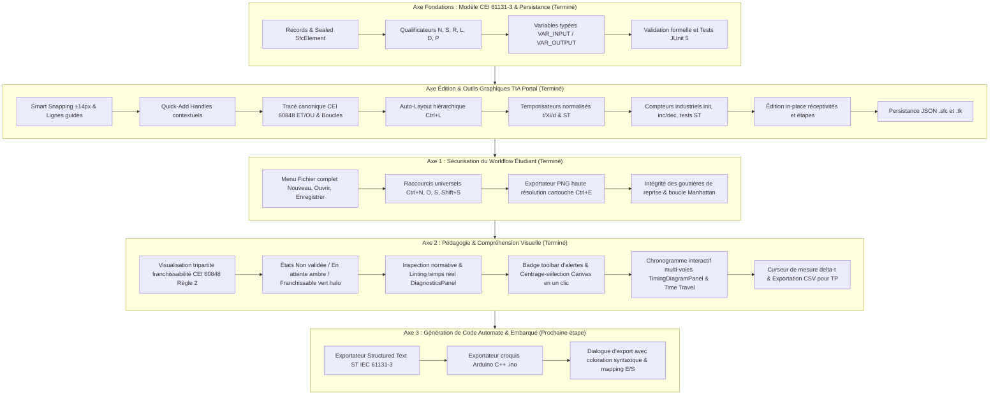

# Guide pour Agents et Développeurs — Projet Grafino

## 1. Contexte & Mission du Projet

**Grafino** est un environnement logiciel pédagogique open-source conçu pour l'enseignement et l'ingénierie des automatismes industriels selon la norme internationale **SFC (Sequential Function Chart — CEI 61131-3)** et le **Grafcet (CEI 60848)**.

Le projet est principalement destiné aux étudiants et formateurs de l'enseignement technique supérieur (BTS CRSA, BTS CIRA, BUT GEII, Licences professionnelles et Écoles d'ingénieurs).

Le nom **Grafino** symbolise la passerelle entre :
* La modélisation séquentielle graphique formelle (**Grafcet / SFC**).
* L'exécution concrète sur automates programmables industriels (**API / PLC** Siemens, Schneider, Codesys) et cibles embarquées (**Arduino / microcontrôleurs**).

### Objectif global du cycle de développement :
1. **Édition graphique fluide & assistée (style Siemens TIA Portal S7-GRAPH)** :
   * Insertion contextuelle intelligente en un clic (*Smart Quick-Add Handles* [＋], [⑂], [✕] directement sur le Canvas).
   * Raccourcis clavier universels rapides (`T`/`Entrée` transition, `S`/`Entrée` étape, `B` branche, `Suppr` suppression) permettant d'épurer la barre d'outils supérieure des boutons redondants.
   * Aimantation magnétique automatique (*Smart Snapping* à $\pm 14\text{ px}$) avec lignes guides de repère.
   * Auto-Layout et centrage hiérarchique instantané (`Ctrl + L` / bouton `📐 Aligner`).
   * Navigation Pan & Zoom fluide centré sur le curseur (`Ctrl + Molette`).
   * Édition in-place directe sur le Canvas (double-clic pour éditer réceptivités et étapes).
   * Panneaux latéraux d'édition en **accordéons repliables ergonomiques** (`CollapsibleSection`) évitant toute surcharge visuelle et intégrant un défilement `ScrollPane` fluide sur toutes résolutions.
2. **Sécurisation du flux de travail étudiant & Persistance UI** :
   * Menu Fichier complet (`Nouveau`, `Ouvrir`, `Enregistrer`, `Enregistrer sous`, `Exporter PNG`).
   * Raccourcis clavier universels (`Ctrl + N`, `Ctrl + O`, `Ctrl + S`, `Ctrl + Shift + S`, `Ctrl + E`).
   * Exportation documentaire PNG haute résolution (échelle x2 avec titre et cartouche pour rapports de TP).
   * Synchronisation dynamique du titre de la fenêtre avec le fichier ouvert et indicateur de modification.
   * **Table des variables d'automatismes rétractable** : fermée par défaut au démarrage et ancrée en bas sans zone résiduelle (`SplitPane.setResizableWithParent(tableContainer, false)` et `maxHeight` contrainte à l'en-tête), dépliable en un clic sur l'en-tête ou le bouton `▲ Agrandir`.
3. **Pédagogie & Compréhension Visuelle en Simulation** :
   * **Visualisation tripartite de franchissabilité** selon la Règle 2 CEI 60848 :
     - *Non validée* (trait sombre `#4B5563`, étapes amont inactives).
     - *Validée en attente* (trait ambré `#F59E0B`, pulsation et badge `[⏳ T<n>]`, étapes amont actives mais réceptivité fausse).
     - *Franchissable* (halo vert `#10B981`, flèche dynamique `▶` et badge `[✓ T<n>]`, prête au franchissement synchrone).
   * **Inspection normative & Linting en direct** (`DiagnosticsPanel`) :
     - Badge toolbar dynamique (`✓ Conforme`, `⚠ Alertes`, `✕ Erreurs`).
     - Détection continue des non-conformités (absence d'étape initiale, non-alternance, temporisations orphelines, compteurs sans qualificateur impulsionnel `P`).
     - Bouton `[🔍 Localiser]` pour centrer et surligner instantanément l'élément fautif sur le Canvas.
   * **Chronogramme d'Évolution Multi-voies interactif** (`TimingDiagramPanel`) :
     - Échantillonnage cyclique temps réel sans fuite mémoire (`TimingRecorder` et `TimingSample`).
     - Formes d'ondes digitales pour les étapes $X_n$, entrées $\%I$, sorties $\%Q$ avec remplissage translucide, et analogiques en escalier pour les compteurs $C_n$.
     - Marqueurs ambrés de franchissement de transitions ($T_n$).
     - Curseur d'inspection avec restauration d'état sur le Grafcet (*Time Travel* pédagogique).
     - Curseur de mesure différentielle $\Delta t$ et exportation des relevés au format CSV pour les comptes-rendus de TP.
4. **Simulation synchrone interactive** (pas-à-pas et temps réel, forçage des entrées capteurs `%I`, observation des préactionneurs de sortie `%Q` avec lampes témoins industrielles et compteurs INT, déduplication insensible à la casse des variables pour éviter les artefacts d'affichage).
5. **Génération directe de code cible** (croquis Arduino C++ `.ino` et Structured Text ST CEI 61131-3).

---

## 2. Normes Industrielles de Référence

Le projet prend en compte la complémentarité entre les deux normes fondamentales :
* **CEI 60848 (Grafcet)** : Norme de spécification fonctionnelle graphique pour cahier des charges.
* **CEI 61131-3 (SFC)** : Norme internationale de programmation logicielle pour Automates Programmables Industriels (API).

### Règles Métier Incontournables :
1. **Alternance stricte** : Une étape ne peut être raccordée qu'à une transition, et une transition qu'à une étape. Aucune liaison directe étape-étape ou transition-transition n'est autorisée. Le curseur fournit un retour visuel vert/rouge en temps réel lors du raccordement.
2. **Sens d'évolution et flèches** : L'évolution naturelle s'effectue du haut vers le bas **sans flèche**. Toute liaison ascendante (boucle de reprise vers le haut) comporte obligatoirement une flèche triangulaire orientée vers le haut (`▲`) et transite par une gouttière latérale pour éviter toute collision graphique.
3. **Étape initiale** : Au moins une étape initiale doit être définie (représentée par un double carré concentrique).
4. **Symbole de transition** : Une transition est strictement représentée par un trait simple transversal perpendiculaire à la liaison (repère $T_n$ à gauche, condition en Structured Text à droite).
5. **Structures de divergence et convergence** :
   * **Sélection de séquence (OU)** : trait horizontal simple continu reliant l'ensemble des branches alternatives descendantes ($X_{min}$ à $X_{max}$).
   * **Parallélisme / Synchronisation (ET)** : **double barre horizontale** continue (exactement 2 lignes parallèles avec écartement de $6\text{ px}$) reliant les branches descendantes.
   * **Exclusion stricte des boucles de reprise (retours ascendants)** : les liaisons ascendantes ne participent jamais aux barres de convergence ou de divergence du flux principal direct. Une boucle de reprise se raccorde directement à son étape cible sans générer de barre horizontale parasite.
   * **Routage adaptatif de la gouttière** : la gouttière de remontée s'adapte à la disposition spatiale relative (gouttière à droite si la source est à droite de la cible, à gauche sinon) pour éviter toute collision graphique.
6. **Qualificateurs d'actions CEI 61131-3** :
   * `N` : Non-stored (action continue pendant l'activité de l'étape).
   * `S` : Set / Mémorisé à 1.
   * `R` : Reset (remise à 0).
   * `P`, `P1`, `P0` : Impulsions (Pulse) sur front d'activation ou désactivation.
   * `L` : Time Limited (action limitée dans le temps `T#...`).
   * `D` : Time Delayed (action retardée par une temporisation `T#...`).
   * `SD`, `DS`, `SL` : Combinaisons temporisées et mémorisées.
7. **Typage et Adressage des variables (CEI 61131-3)** :
   * Types de données : `BOOL`, `BYTE`, `WORD`, `INT`, `DINT`, `REAL`, `TIME` (`T#2s`), `STRING`.
   * Portées : `VAR_INPUT` (%I), `VAR_OUTPUT` (%Q), `VAR` (%M local), `VAR_GLOBAL` (%G).
   * Format d'adresse matérielle : `%[I|Q|M][X|B|W|D]?[0-9]+(\.[0-9]+)?` (ex : `%I0.0`, `%Q0.1`, `%M0.0`, `%IW2`).
   * Couplage bidirectionnel strict entre la portée et l'adresse avec résolution automatique des collisions.
8. **Temporisateurs dans les transitions (CEI 60848 & CEI 61131-3)** :
   * **Format Grafcet standard CEI 60848 (format par défaut de Grafino)** : $t_n / X_i / d$ (générique $t / X_i / d$, ex : `t/X1/5s`, `t1/X2/500ms`). La réceptivité devient vraie dès que l'étape associée $X_i$ (par défaut l'étape amont directe) a été active de manière continue pendant la durée $d$.
   * **Format Structured Text CEI 61131-3** : $X_i.t \ge T\#d$ ou $Step_i.t \ge T\#d$ (ex : `X1.t >= T#5s`).
   * Assistant interactif dans la barre latérale avec détection automatique de l'étape amont, calcul d'aperçu dynamique et injection contextuelle.
9. **Compteurs industriels (CEI 60848 & CEI 61131-3 Structured Text)** :
   * **Initialisation** : action d'étape avec assignation `C1 := 0` (ou valeur initiale personnalisée).
   * **Évolution (Incrémentation / Décrémentation)** : `C1 := C1 + 1` ou `C1 := C1 - 1`.
   * **Règle Pédagogique Qualificateur P** : l'évolution de compteur doit impérativement utiliser le qualificateur impulsionnel `P` (Pulse) pour ne s'exécuter qu'une seule fois par passage dans l'étape (et non à chaque cycle automate continu `N`).
   * **Tests de réceptivité** : expressions comparatives en Structured Text (`C1 < 5` pour boucle de reprise, `C1 >= 5` pour fin de lot, `=`, `<>`, `>`, `<=`).

---

## 3. Architecture Technique & Bonnes Pratiques Java 27+

Le projet applique une séparation stricte des responsabilités (Clean Architecture / Modèle Découplé) :

```
tk.tahri.grafino/
├── model/                     # Modèle métier pur CEI 61131-3 (AUCUNE dépendance JavaFX)
│   ├── SfcElement.java        # Sealed interface racine (permits SfcStep, SfcTransition, SfcBranch)
│   ├── SfcStep.java           # Record d'étape (id, name, number, isInitial, actionBlocks)
│   ├── SfcTransition.java     # Record de transition (id, name, number, conditionST en Structured Text)
│   ├── SfcTimerCondition.java # Record de temporisateur normalisé (parsing regex, formats t/Xi/d et ST)
│   ├── SfcCounterOperation.java# Record et utilitaires de compteurs (init C:=0, inc C:=C+1, tests C<5)
│   ├── SfcBranch.java         # Record de synchronisation et aiguillage
│   ├── SfcBranchType.java     # Enum : DIVERGENCE_OR, CONVERGENCE_OR, DIVERGENCE_AND, CONVERGENCE_AND
│   ├── SfcLink.java           # Record d'arc orienté avec points de routage Manhattan
│   ├── SfcPoint.java          # Coordonnée 2D pure (x, y)
│   ├── SfcQualifier.java      # Enum des qualificateurs CEI 61131-3 (N, S, R, P, L, D, SD, DS, SL)
│   ├── SfcActionBlock.java    # Record d'action (qualificateur, variable cible, durée Duration, condition)
│   ├── IecDataType.java       # Types de données élémentaires (BOOL, INT, REAL, TIME...)
│   ├── IecVariableScope.java  # Portées IEC : VAR_INPUT (%I), VAR_OUTPUT (%Q), VAR (%M), VAR_GLOBAL
│   ├── IecVariable.java       # Record de variable automate (nom, type, portée, adresse, valeur init)
│   ├── SfcProgram.java        # Conteneur POU racine (Program Organization Unit) avec validation formelle
│   └── SfcValidationMessage.java # Diagnostics d'analyse sémantique et erreurs de règles
│
├── storage/                   # Persistance JSON indépendante (zéro dépendance externe)
│   ├── JsonValue.java         # Sealed interface du modèle AST JSON (records JsonObject, JsonArray...)
│   ├── JsonParser.java        # Parseur et formateur JSON natif
│   └── SfcStorage.java        # Sauvegarde/chargement .sfc et rétrocompatibilité .tk
│
├── simulation/                # Moteur de Simulation Synchrone CEI 60848 (zéro dépendance JavaFX, 100% testable)
│   ├── SimulationState.java   # Marquage instantané des étapes (Xn), horodatages Tn, entrées/sorties et compteurs
│   ├── ReceptivityEvaluator.java # Évaluateur booléen (NOT, AND, OR), temporisateurs t/Xi/d et tests compteurs
│   ├── SimulationStepResult.java # Rapport d'évolution cyclique (transitions franchies, étapes activées/désactivées)
│   ├── GrafcetSimulator.java  # Moteur d'évolution cyclique synchrone appliquant les 5 règles fondamentales CEI 60848
│   ├── TimingSample.java      # Record d'instantané temporel des signaux Xn, %I, %Q, Cn et transitions franchies
│   └── TimingRecorder.java    # Buffer circulaire d'échantillonnage temporel, recherche dichotomique et export CSV
│
├── component/                 # Composants visuels pour le Canvas JavaFX
│   ├── Component.java         # Classe de base des éléments graphiques (Teal #008184, sélection jaune #FFCC00)
│   ├── StepAndTransitionCommonBehavior.java # Interactions, poignées contextuelles TIA Portal ([+], [⑂], [✕])
│   ├── Step.java              # Rendu de l'étape (simple ou double cadre initial), jeton actif ● et blocs d'actions allumés
│   ├── Transition.java        # Rendu de la transition (trait transversal, rendu tripartite simulation: non validée, attente, franchissable)
│   ├── Link.java              # Tracé orthogonal Manhattan, double barre ET, simple barre OU, boucle ascendante à gouttière adaptative
│   ├── Action.java            # Association graphique d'action (qualificateur, variable ou expression ST)
│   └── Variable.java          # Modèle observable avec validation et couplage scope/adresse
│
└── ui/                        # Interface Utilisateur JavaFX inspirée d'Arduino IDE & TIA Portal
    ├── AppTheme.java          # Design tokens & charte visuelle (Teal Arduino #008184, cartes, puces, couleurs sémantiques)
    ├── CollapsibleSection.java# Sections en accordéon repliables (chevron dynamique ▼/▶, badges contextuels, scroll fluide)
    ├── DiagnosticsPanel.java  # Panneau latéral d'inspection normative et linting en direct (CEI 60848 & CEI 61131-3)
    ├── MainUI.java            # Fenêtre principale avec SplitPane vertical, onglets Variables / Chronogramme et gestion de projet
    ├── Grafcet.java           # Canvas fluide (Smart Snap, auto-layout, export PNG haute résolution, sélection d'élément)
    ├── AppMenuBar.java        # Barre de menus principale (Fichier, Édition, Affichage, Simulation, Aide, badge linting, simulation)
    ├── TopToolBar.java        # Alias rétrocompatible vers AppMenuBar
    ├── SimulationPanel.java   # Pupitre virtuel droit dédupliqué (boutons poussoirs/bascules %I, lampes LED %Q, compteurs)
    ├── TimingDiagramPanel.java# Chronogramme interactif multi-voies (zoom temporel, curseurs Δt, time-travel, export CSV)
    ├── StepProperty.java      # Sidebar d'étape en accordéon (initiale CEI 60848, action %Q, compteur, liste d'actions)
    ├── TransitionProperty.java# Sidebar de transition en accordéon (condition ST, capteurs %I/opérateurs, tempo t/Xi/d, test compteur)
    └── VariableTable.java     # Table des variables (onglets chromatiques, recherche, boutons %I/%Q/%M et Compteur INT)
```

### Principes appliqués :
* **`records`** : Modélisation immuable des données de domaine (`SfcStep`, `SfcTransition`, `SfcActionBlock`, `IecVariable`, `SfcProgram`).
* **`sealed interface`** : `SfcElement permits SfcStep, SfcTransition, SfcBranch` garantissant l'exhaustivité totale lors des expressions `switch` avec pattern matching.
* **Indépendance UI** : Le paquet `tk.tahri.grafino.model` n'importe aucune classe JavaFX, permettant l'exécution de simulations et de tests unitaires ultra-rapides en mode headless.
* **Smart Alignment** : Algorithme `computeSmartSnap` avec tolérance dynamique de $\pm 14\text{ px}$ et détection prioritaire des relations de parenté.
* **Auto-Layout BFS** : Algorithme de placement hiérarchique régulier ordonnant les couches en tenant compte des divergences et convergences sans chevauchement.

---

## 4. Charte Graphique & Design System

L'interface associe les codes visuels emblématiques de **l'IDE Arduino** et la rigueur fonctionnelle de **TIA Portal** :

| Rôle | Teinte | Hex | Usage |
| :--- | :--- | :--- | :--- |
| **Arduino Teal (Primaire)** | Teal classique | `#008184` | Accent principal, barre d'outils, boutons d'action majeurs |
| **Teal Vibrant (Accent)** | Teal clair | `#00979D` | Survol, boutons de sortie `%Q`, lignes guides de repère magnétique |
| **Sélection Canvas (Jaune)** | Jaune vif | `#FFCC00` | Contour de surbrillance de l'étape, transition ou liaison sélectionnée |
| **Entrées Capteurs (%I)** | Vert Émeraude | `#10B981` | Bouton d'ajout rapide `＋ Entrée (%I)`, validation de raccordement conforme |
| **Sorties Préactionneurs (%Q)**| Bleu Cyan | `#0284C7` | Bouton d'ajout rapide `＋ Sortie (%Q)` et bouton de branche `[⑂]` |
| **Mémoires Internes (%M)** | Violet / Pourpre | `#7C3AED` | Bouton d'ajout rapide `＋ Mémoire (%M)` et onglet actif |
| **Teal Light (Surfaces & Puces)**| Fond cyan doux | `#E5F5F5` | Fond des puces capteurs `%I`, badges actifs, surlignage |
| **Arduino Orange** | Orange d'alerte | `#E67E22` | Badge Transition `T<n>`, qualificateurs temporisés `L`/`D` |
| **Arduino Red** | Rouge brique | `#D9381E` | Actions Reset `R`, bouton suppression `[✕]` / `🗑`, alerte de violation d'alternance |
| **Grille technique** | Gris bleuté doux | `#D7DEE4` | Quadrillage à points d'ingénierie TIA Portal (pas de 24px) |
| **Surfaces Principales** | Blanc pur | `#FFFFFF` | Surface du Canvas Grafcet, fond des cartes d'édition |
| **Surfaces Secondaires** | Gris très doux | `#F7F9FA` | Fond des panneaux latéraux (`Sidebar`), fond de la table |
| **Bordures & Séparateurs** | Gris neutre | `#E1E4E8` | Séparateurs, contours de champs de texte et de cartes |
| **Typographie Code** | Monospace | `'JetBrains Mono', Consolas` | Adresses API (`%I0.0`), expressions ST, réceptivités in-place |

---

## 5. Raccourcis Clavier & Ergonomie de Dessin

| Raccourci | Action |
| :--- | :--- |
| **`Ctrl + N`** | **Nouveau projet SFC / Grafcet** (avec confirmation si diagramme non vide) |
| **`Ctrl + O`** | **Ouvrir un programme** existant (`.sfc` ou `.tk`) |
| **`Ctrl + S`** | **Enregistrer le projet actif** (`.sfc`) |
| **`Ctrl + Shift + S`** | **Enregistrer sous un nouveau nom ou format** |
| **`Ctrl + E`** | **Exporter en image PNG haute résolution** (pour rapports de TP) |
| **`Ctrl + K`** | **Ouvrir / Basculer sur le Chronogramme d'Évolution Multi-voies** |
| **`T`** ou **`Entrée`** | Insérer la Transition suivante après l'Étape sélectionnée |
| **`S`** ou **`Entrée`** | Insérer l'Étape suivante après la Transition sélectionnée |
| **`B`** | Ouvrir une branche (OU sur une étape, ET sur une transition) |
| **`Suppr`** / **`Retour arrière`** | Supprimer l'élément ou la liaison sélectionnée |
| **`Ctrl + L`** | **Auto-Layout : réaligner et centrer automatiquement tout le diagramme** |
| **`Ctrl + Molette`** | Zoom fluide centré sur le curseur |
| **`Clic Milieu / Droit + Glisser`** | Déplacement panoramique (*Pan*) dans le schéma |
| **`Double-clic sur Transition`** | Édition in-place immédiate de la réceptivité sur le Canvas |
| **`Double-clic sur Étape`** | Édition in-place immédiate du numéro d'étape |
| **`Échap`** | Désélectionner tout |

---

## 6. Spécification du Format de Fichier JSON (`.sfc` / `.tk`)

Exemple de structure d'un programme POU SFC standard :
```json
{
  "programName": "Perceuse_Automatique",
  "variables": [
    {
      "name": "dcy",
      "type": "BOOL",
      "scope": "VAR_INPUT",
      "hardwareAddress": "%I0.0",
      "initialValue": "FALSE",
      "description": "Bouton Départ de Cycle"
    },
    {
      "name": "ROTATION",
      "type": "BOOL",
      "scope": "VAR_OUTPUT",
      "hardwareAddress": "%Q0.0",
      "initialValue": "FALSE",
      "description": "Moteur rotation broche"
    }
  ],
  "steps": [
    {
      "id": "s0",
      "name": "Step0",
      "number": 0,
      "isInitial": true,
      "x": 400.0,
      "y": 60.0,
      "actionBlocks": []
    },
    {
      "id": "s1",
      "name": "Step1",
      "number": 1,
      "isInitial": false,
      "x": 400.0,
      "y": 200.0,
      "actionBlocks": [
        {
          "qualifier": "N",
          "variableName": "ROTATION",
          "duration": null,
          "inlineCondition": null
        }
      ]
    }
  ],
  "transitions": [
    {
      "id": "t1",
      "name": "T1",
      "number": 1,
      "conditionST": "dcy",
      "x": 400.0,
      "y": 130.0
    }
  ],
  "links": [
    {
      "id": "l1",
      "sourceId": "s0",
      "targetId": "t1",
      "intermediatePoints": []
    }
  ],
  "branches": []
}
```

---

## 7. Feuille de Route (Roadmap d'Amélioration)



---

## 8. Commandes de Compilation & Exécution

### Prérequis
* **JDK 27+** (avec JavaFX 27)
* **Gradle 9.8+** (ou script `./gradlew`)

### Commandes usuelles :
```bash
# Lancer l'application Grafino
./gradlew run

# Exécuter l'ensemble des tests unitaires automatisés (modèle, temporisateurs, compteurs, stockage, graphisme)
./gradlew test

# Nettoyer les artefacts de build
./gradlew clean
```
